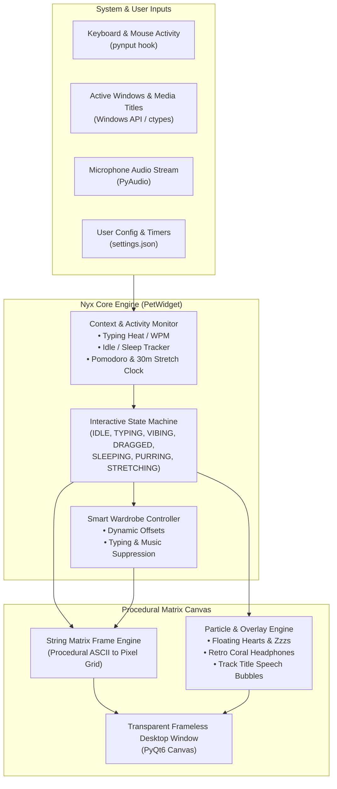
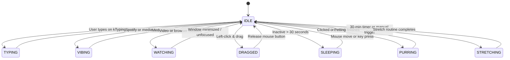
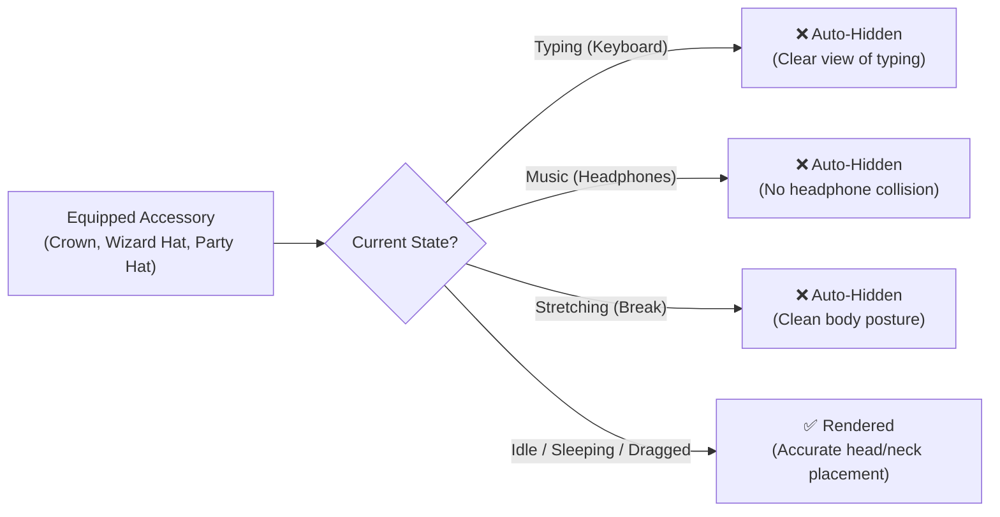

<div align="center">
  <h1>✨ Nyx ✨<br>Your Cozy Desktop Companion 🐾</h1>
  <p>A lightweight, interactive pixel pet that lives on your screen to keep you company, help you focus, and vibe with your daily workflow!</p>
  
  
  
</div>

---

## 🌟 What's New in v1.3.0?

Nyx has received a major visual polish and feline grace upgrade, featuring extended resting paws, an organic scruff-drag redesign, seamless connected tail anatomy, and hand-crafted feline coats!

- **🐾 Extended Front Paws & Rounded Mittens:**
  - Front paws extend forward naturally in `IDLE`, `SLEEPING`, `VIBING` (music), `WATCHING`, and `PURRING` animations.
  - Features individual rounded kitten mitten paw contours and clean floor seals behind the paws for a relaxed, resting loaf posture.
- **🐱 Organic Dragged Scruff Animation Redesign:**
  - Soft feline waist taper (`width 18 → 16`) and rounded hips (`width 20`) replacing the rigid 5-row rectangular column.
  - Symmetrical 7-pixel dangling legs with cute rounded mitten paws (`..WWWWW..`) replacing the flat wooden blocks.
  - Fluid bicycle pedaling kick cycle across 3 frames with 1-pixel vertical stepping (`Frame 0: Left 38, Right 36` → `Frame 1: Mid-swing 37` → `Frame 2: Left 36, Right 38`).
  - Glitch-free curving tail swaying naturally by 1 pixel per frame with zero internal white streak artifacts.
- **✨ Pixel-Perfect Connected Sitting Tail:**
  - Completely re-engineered tail base across rows 25–28 in all sitting poses.
  - 100% physically connected body-to-tail pixels (verified via BFS graph traversal).
  - Completely eliminated both the disconnected floating tail gap and the jagged rectangular bottom-right rump shelf.
- **🎨 7 Curated Coats & Feline Skins (with Crisp Protected Eyes):**
  - Choose between sleek solid shades and hand-crafted feline coats:
    - 🌑 **Black:** Classic sleek obsidian midnight shade.
    - 🌪️ **Slate:** Cool smoky graphite slate shade.
    - 🌊 **Navy:** Deep oceanic midnight starlight blue.
    - ☕ **Espresso:** Rich roasted coffee mocha brown.
    - 🎩 **Tuxedo:** Dapper black cat with a neat white chest ascot and cute white ankle socks on dangling paws.
    - 🧡 **Ginger:** Warm marmalade tabby with sweet cinnamon stripes and bright white eye rings.
    - 🎨 **Calico:** Soft light grey coat with ginger and black ear-to-eye split, colored legs, and sparkling anime eyes.
  - 👁️ **Eye Protection:** Face and eye zones are strictly protected—stripes and patches never cut across the eyes, paws, or keyboard.
  - Pick between 3 crisp pixel sizes: **Small (2x)**, **Medium (3x)**, and **Large (4x)**.
- **👑 Scaled-Up Royal Accessories:**
  - 👑 **Grand Golden Crown:** A majestic, larger royal gold crown with ruby and sapphire jewel insets, centered proudly on Nyx's head.
  - 🧙 **Grand Wizard Hat:** A stylish, larger pointed mystical violet wizard hat with a celestial golden sash and glowing star tip.
  - 🎉 **Party Hat:** A joyful festive cone party hat featuring colorful confetti stripes and a fluffy white pom-pom.
  - 🧠 **Smart Context Hiding:** Accessories automatically tuck away while typing on the keyboard or jamming with headphones so there is never visual clutter.
- **🎵 "Now Playing" Track Pop-Up:**
  - When you listen to music on Spotify or supported media players, Nyx automatically pops up a cute speech bubble announcing the song title (e.g. `🎵 Now Playing: Starboy`) as soon as the track changes. Click directly on the bubble to dismiss it immediately!
- **🧘 Authentic Stretch Break Reminder & Animation:**
  - Nyx reminds you to stretch every 30 minutes with a dedicated 6-frame Comnyang stretching animation (arched back, anchored front paws, squint eyes `><`, and curled tail).
  - Includes a **"Stretch Now"** button in settings to trigger your break anytime.

---

## 🌟 What is Nyx?

Nyx is a completely free, open-source desktop overlay inspired by cozy virtual pets and companions. Nyx sits happily on your desktop, fully transparent and frameless, reacting to your mouse, keystrokes, and active apps without ever getting in your way! 🧡

---

## 📐 Architecture & How It Works

Nyx runs asynchronously with low CPU usage, combining Windows OS hooks, an event-driven state machine, and a procedural pixel engine:



---

## 🐈 Features & Animations

Nyx is powered by a custom procedural string matrix engine: every frame is drawn natively with crisp pixel edges and full dynamic color support!

### 🔄 Reactive State Machine

Nyx continuously monitors system activity and transitions smoothly between states:



### 🎮 Interactive Animations
* **🖱️ Drag & Drop:** Click and hold to pick Nyx up. Nyx dangles cutely with organic body tapering, soft rounded kitten mitten paws, and a fluid bicycle pedaling kick cycle as you move it across the desktop.
* **🐾 Resting Paws:** When sitting idle, resting, sleeping, or vibing to music, Nyx extends its front paws forward into cozy rounded mittens.
* **⌨️ Keyboard Kneading:** Start typing code or writing documents, and Nyx taps its paws along with your keystrokes. Fast typing even makes Nyx sweat heat steam!
* **👀 Cursor Tracking & Blinking:** Nyx's eyes follow your mouse cursor smoothly around your monitors, with natural blinking intervals when idle.
* **💕 Purring:** Click or pet Nyx to make it happy! It will close its eyes in bliss and float gentle pink hearts.
* **🎙️ Voice Reactions (Mic Support):** Speak into your microphone and Nyx opens its mouth in real-time to talk back with you.
* **💤 Sleep Mode:** Step away from your computer for 30 seconds, and Nyx curls up into a peaceful nap with floating blue Zzzs.

### 🎩 Wardrobe & Context-Aware Accessories

Accessories automatically adjust and suppress themselves depending on what Nyx is currently doing:



### 📱 App & Media Reactions
* **🎧 Vibing:** Open **Spotify** or a music player, and Nyx throws on retro coral headphones to bob to the beat.
* **🎵 Now Playing Speech Bubble:** Track changes pop up right above Nyx's head so you always know what song is playing.
* **📺 Watching:** Switch to **YouTube** or a video player, and Nyx widens its eyes to watch videos attentively with you.

### ⏰ Productivity & Health Tools
* **🍅 Pomodoro Timers:** Toggle customizable focus intervals and break timers right from the settings window.
* **🧘 Posture & Stretch Reminders:** Set reminders every 30 minutes to stretch alongside Nyx.
* **💬 Pinned Sticky Notes:** Keep a quick task or reminder pinned in a speech bubble above Nyx's head.

---

## 🚀 How to Run (Easy Way)

You do not need to know how to code to enjoy Nyx!

1. Go to the [Releases](https://github.com/MukundhArul/Nyx/releases) page on GitHub.
2. Download `Nyx_Cat.exe` (or `Nyx.exe`).
3. Place it anywhere on your computer (e.g. your Desktop or Startup folder).
4. Double-click `Nyx_Cat.exe` to run it!
*(Note: Windows SmartScreen may show an unrecognized app banner on first launch. Click "More info" and "Run anyway").*

---

## 🛠️ For Developers (Build From Source)

### 1. Clone the repository
```bash
git clone https://github.com/MukundhArul/Nyx.git
cd Nyx
```

### 2. Set up your virtual environment
```bash
python -m venv venv

# Windows (Command Prompt / PowerShell):
.\venv\Scripts\activate
```

### 3. Install dependencies
```bash
pip install PyQt6 pynput psutil Pillow PyAudio PyGetWindow
```

### 4. Run Nyx
```bash
python app.py
```

### 5. Build Standalone Executable (Optional)
```bash
pip install pyinstaller
pyinstaller --noconfirm --onefile --windowed --name Nyx_Cat --icon=cat.ico app.py
```

---

## ⚙️ Settings & Controls

* **Right-Click Nyx or System Tray Icon**:
  - Open **Settings** dialog
  - Quick-switch **Wardrobe Accessories** (None, Golden Crown, Wizard Hat, Party Hat)
  - Quick-switch **Coat Presets & Skins** (Black, Slate, Navy, Espresso, Tuxedo, Ginger, Calico)
  - Quick-trigger **Stretch Now**
  - Toggle **Always on Top**
  - Reset to Default or Exit Nyx

* **Tabbed Settings Window**:
  - **🎩 Wardrobe**: Preview and equip head accessories in a clean 2x2 card grid.
  - **🎨 Appearance**: Choose between 7 coats and feline skins (Black, Slate, Navy, Espresso, Tuxedo, Ginger, Calico); select Small (2x), Medium (3x), or Large (4x) cat sizes; toggle typing paw tap reactions.
  - **⏱️ Timers**: Configure Pomodoro study/work intervals, break reminders, and pinned message bubbles.

---

<div align="center">
  <i>Built with ❤️ for a cozier desktop experience.</i>
</div>
