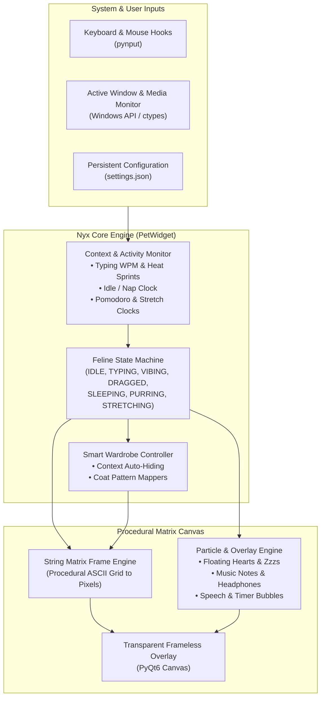
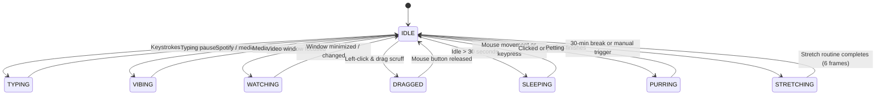

<div align="center">

# ✨ Nyx ✨
### *Your Cozy, Interactive Desktop Pet Companion* 🐾

<p align="center">
  A lightweight, frameless, transparent pixel cat that lives on your screen to keep you company, vibe with your music, react to your workflow, and help you stay focused!
</p>

[](https://github.com/MukundhArul/Nyx/releases)
[](https://www.python.org/)
[](https://riverbankcomputing.com/software/pyqt/)
[](LICENSE)

---

[✨ Key Features](#-features--animations) •
[🚀 Quick Start](#-how-to-run-easy-way) •
[🛠️ Developer Setup](#-for-developers-build-from-source) •
[🎨 Customization](#-coats-skins--wardrobe) •
[⚙️ Controls & Settings](#️-settings--controls) •
[📐 Architecture](#-architecture--how-it-works)

---

</div>

## 🌟 What is Nyx?

**Nyx** is a cozy, open-source desktop overlay companion inspired by classic virtual desktop pets. Built with Python and PyQt6, Nyx rests comfortably above your open windows, floating seamlessly across your desktop without borders or title bars.

Nyx is deeply reactive to how you work:
- Tap away on your keyboard, and Nyx kneads along with your keystrokes.
- Turn on Spotify or your favorite music, and Nyx puts on retro coral headphones to bob to the beat.
- Switch to YouTube or video streams, and Nyx widens its eyes to watch with you.
- Step away from your computer, and Nyx curls up for a peaceful nap with soft floating Zzzs.
- Need a healthy reminder? Nyx alerts you to take posture stretch breaks and hydrate, and features a built-in Pomodoro study timer!

---

## 🐈 Features & Animations

### 🎮 Living, Reactive Feline Behaviors
* **🐾 Cozy Resting Paws:** In sitting loaf postures (`IDLE`, `SLEEPING`, `VIBING`, `WATCHING`, and `PURRING`), Nyx extends its front paws forward into soft, rounded kitten mittens (`..WWWWW..`) anchored cleanly to the desktop floor.
* **⌨️ Real-Time Keyboard Kneading:** Start typing code or writing documents, and Nyx taps its paws synchronously with your keystrokes. Sustained typing speeds over 60 WPM even trigger hot typing heat steam!
* **👀 Dynamic Cursor Following & Natural Blinks:** Nyx's pupils smoothly track your mouse cursor across multi-monitor setups, complete with gentle natural blinking intervals when resting.
* **🖱️ Fluid Mochi Drag Physics:** Click and pick Nyx up by the scruff! Nyx dangles with an organic feline waist taper (`width 18 → 16`), rounded hips (`width 20`), symmetrical 7-pixel dangling legs, soft mitten paws, and a fluid 3-frame bicycle pedaling kick cycle with inertia pendulum tilt.
* **✨ Pixel-Perfect Connected Tail:** Seamless body-to-tail connection across rows 25–28 with zero floating gaps or jagged artifacts.
* **💕 Purring & Petting:** Click or gently pet Nyx to make it happy! Nyx closes its eyes in bliss and floats soft pink pixel hearts.
* **💤 Automatic Nap Mode:** Inactive for more than 30 seconds? Nyx curls up into a peaceful sleep with floating cyan Zzz particles, waking up gently as soon as you move your mouse.

---

### 📱 Smart App & Media Detection
* **🎧 Vibing to Music:** Automatically detects **Spotify** or active media players. Nyx equips retro coral headphones and bobs rhythmically while colorful pastel music notes drift upward.
* **🎵 "Now Playing" Song Pop-Ups:** Whenever your track changes, a clean speech bubble pops up over Nyx's head showing the new song title (e.g. `🎵 Now Playing: Starboy`). Click directly on the bubble anytime to dismiss it instantly!
* **📺 Watching Videos:** Detects when you're watching video in browsers or media players, prompting Nyx to widen its eyes in attentive screen gazing.

---

### ⏱️ Productivity & Health Reminders
* **🧘 Posture Stretch Breaks:** Nyx reminds you to take a stretch break every 30 minutes with an authentic 6-frame Comnyang stretching animation (arched back, anchored front paws, squint eyes `><`, and curled tail). Includes a **"Stretch Nyx 🐾"** manual trigger in the menu.
* **💧 Hydration Reminders:** Gentle periodic reminders to drink water so you stay refreshed while working or gaming.
* **🍅 Pomodoro Study Clock:** Configurable focus intervals (default: 25 min) and short break intervals (default: 5 min) displayed in a tidy floating countdown bubble above Nyx's head.
* **💬 Pinned Sticky Reminders:** Pin any quick task, goal, or inspirational memo into a permanent speech bubble over Nyx.

---

## 🎨 Coats, Skins & Wardrobe

### 🐾 7 Curated Feline Coats
Nyx features hand-crafted feline coat patterns with strictly protected eye and face zones:

| Coat | Icon | Description |
|---|:---:|---|
| **Black** | 🌑 | Classic sleek obsidian midnight coat with crisp white outlines. |
| **Slate** | 🌪️ | Cool smoky graphite slate shade with clean modern tones. |
| **Navy** | 🌊 | Deep oceanic midnight starlight blue. |
| **Espresso** | ☕ | Rich roasted coffee mocha brown. |
| **Tuxedo** | 🎩 | Dapper black cat with an organic white chest ascot and cute white mitten socks. |
| **Ginger** | 🧡 | Warm marmalade tabby with sweet cinnamon tiger stripes on forehead, cheeks, flanks, and tail with bright white eye rings. |
| **Calico** | 🎨 | Soft light grey coat with abstract organic ginger and black blotches, ear-to-eye split, and dual-colored paw socks. |

*Choose between 3 crisp pixel scale factors in Settings:* **Small (2x)**, **Medium (3x)**, or **Large (4x)**.

---

### 🎩 Smart Context-Aware Wardrobe
Nyx features royal and festive headwear designed to fit comfortably atop Nyx's head:
- 👑 **Grand Golden Crown:** Majestic royal gold crown with sparkling ruby and sapphire jewel insets.
- 🧙 **Grand Wizard Hat:** Mystical violet pointed wizard hat with celestial golden sash and glowing star tip.
- 🎉 **Party Hat:** Festive party cone featuring vibrant confetti stripes and a fluffy pom-pom.

> **🧠 Smart Auto-Hiding:** Equipped accessories automatically tuck away while typing on the keyboard, wearing music headphones, or stretching, preventing visual overlap.

---

## 📐 Architecture & How It Works

Nyx is engineered for near-zero idle CPU usage (~0.1% CPU) using non-polling system event hooks and an event-driven PyQt6 graphics pipeline:



### 🔄 Interactive State Machine



---

## 🚀 How to Run (Easy Way)

You do **not** need Python installed to use Nyx!

1. Head to the **[Releases](https://github.com/MukundhArul/Nyx/releases)** page on GitHub.
2. Download **`Nyx_Cat.exe`** (or grab the zip bundle).
3. Place `Nyx_Cat.exe` in any folder (or drop a shortcut into your Windows Startup folder: `shell:startup`).
4. Double-click **`Nyx_Cat.exe`** to launch!

> *Note: Windows SmartScreen may show an unrecognized application prompt on first launch. Click **"More info"** → **"Run anyway"**.*

---

## 🛠️ For Developers (Build From Source)

### 1. Clone the Repository
```bash
git clone https://github.com/MukundhArul/Nyx.git
cd Nyx
```

### 2. Set Up Virtual Environment
```bash
python -m venv venv

# Windows PowerShell:
.\venv\Scripts\Activate.ps1

# Windows Command Prompt:
.\venv\Scripts\activate.bat
```

### 3. Install Dependencies
```bash
pip install PyQt6 pynput pygetwindow
```

### 4. Run Nyx
```bash
python app.py
```

### 5. Build Standalone Executable (Optional)
```bash
pip install pyinstaller
pyinstaller --noconfirm --onefile --windowed --name Nyx_Cat --icon=cat.ico app.py
```

---

## ⚙️ Settings & Controls

### 🖱️ Mouse Controls
* **Left-Click & Drag:** Grab Nyx by the scruff and move it anywhere across your monitors.
* **Left-Click Once:** Pet Nyx to trigger happy purring and floating hearts!
* **Click Speech Bubble:** Dismiss any active track announcement or reminder instantly.
* **Right-Click Nyx:** Opens the quick context menu.

### 📋 System Tray & Context Menu
* **Settings...:** Opens the full tabbed settings dialog.
* **Stretch Nyx 🐾:** Immediately triggers the 6-frame Comnyang stretching break routine.
* **Wardrobe 🎩:** Quick-toggle hats (None, Golden Crown, Wizard Hat, Party Hat).
* **Coat Presets 🐾:** Quick-switch cat coats (Black, Slate, Navy, Espresso, Tuxedo, Ginger, Calico).
* **Always on Top:** Toggle desktop overlay pinning.
* **Set Pinned Message... / Clear Pinned Message:** Pin a task or note above Nyx.
* **Toggle Pomodoro / Set Pomodoro Task...:** Start, pause, or configure your Pomodoro session.
* **Exit Nyx:** Closes the application cleanly.

### 🎛️ Tabbed Settings Window
* **🎩 Wardrobe Tab:** Visual card selector to equip and preview accessories.
* **🎨 Appearance Tab:** Select coats, change pixel size (Small 2x / Medium 3x / Large 4x), and toggle keystroke paw kneading.
* **⏱️ Timers Tab:** Configure Pomodoro focus & break intervals, water reminders, and stretch timer intervals.

---

## 📄 License

This project is licensed under the [MIT License](LICENSE) — free for personal and commercial use.

<div align="center">
  <br>
  <b>Crafted with ❤️ for a cozier, happier desktop workspace.</b><br>
  <i>If you enjoy Nyx, consider starring ⭐ the repository on GitHub!</i>
</div>
